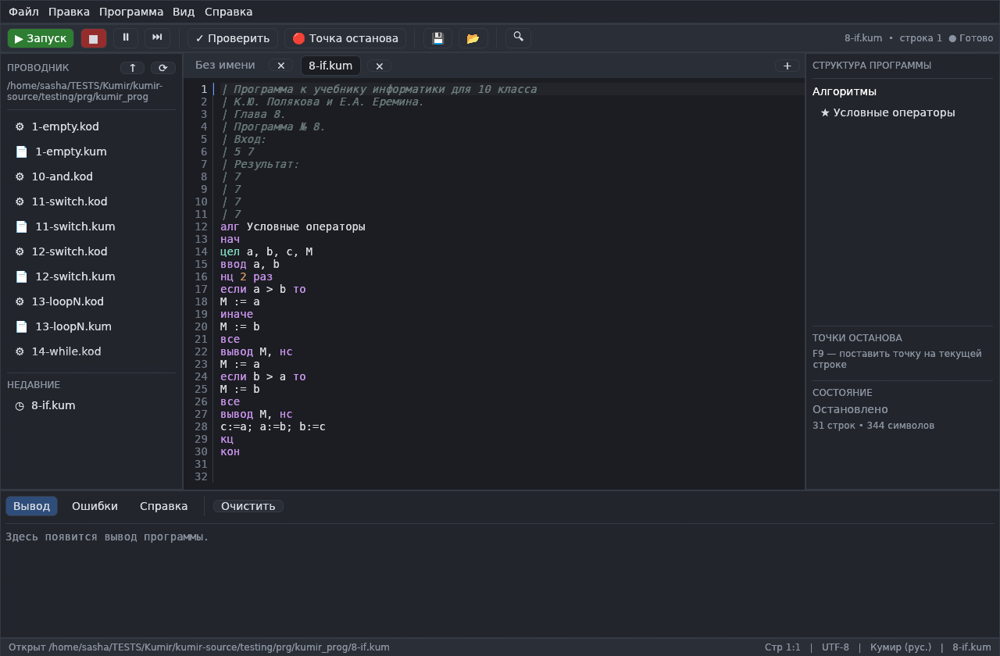

# КуМир на Rust

Современная свободная реализация среды программирования **КуМир 2** на языке
Rust: ядро языка, стандартная библиотека, совместимость с исходными файлами
`.kum` и полностью новый интерфейс IDE.

Проект создан как перенос основного функционала оригинального
[КуМир 2](https://gitlab.com/kumir2/kumir) (GPLv3). Исходная программа содержит
Qt-плагины, байткод-виртуальную машину и набор исполнителей; здесь ядро
переписано с нуля на Rust, а GUI построен на `egui`/`eframe`.



## Возможности

### Язык Кумир

* лексер и парсер русского и английского вариантов языка;
* алгоритмы, параметры `арг` / `рез` / `аргрез`, возврат через `знач`;
* имена алгоритмов и переменных из нескольких слов;
* целые, вещественные, логические значения, символы и строки;
* массивы (`целтаб`, `вещтаб`, …), в том числе многомерные, с индексацией от 1;
* инициализация массивов `{1, 2, 3}`;
* операторы `если`, `выбор`, `нц для`, `нц пока`, `нц N раз`,
  `нц … кц при`, `выход`, `пауза`, `стоп`, `утв`;
* форматированный вывод `вывод x:8:3`, символ `нс`;
* консольный и файловый ввод-вывод;
* `использовать Файлы`, `использовать Строки`, `использовать Робот`,
  `использовать Черепаха`, `использовать Чертежник`;
* подключение пользовательских модулей (`использовать "lib.kum"`);
* директива `ВКЛЮЧИТЬ "file.kum"`.

### Стандартная библиотека

Математика (`abs`, `sqrt`, `sin`, `cos`, `tg`, `arcsin`, `arccos`, `arctg`,
`arcctg`, `exp`, `ln`, `lg`, `min`, `max`, `imin`, `imax`, `sign`, `int`,
`div`, `mod`, случайные числа), строки (`длин`, `код`, `символ`, `юникод`,
`цел_в_лит`, `вещ_в_лит`, `лит_в_цел`, `лит_в_вещ`, `Цел`, `Вещ`, `Лог`,
`позиция`, `вставить`, `удалить`, `заменить`, регистр), файлы
(`открыть на чтение/запись/добавление`, `закрыть`, `конец файла`,
`есть данные`, `существует`, `создать каталог`, `создать файл`,
`полный путь`, `РАБОЧИЙ КАТАЛОГ`, `КАТАЛОГ ПРОГРАММЫ`, …), время и `ждать`.

### IDE

* вкладки, проводник `.kum`-файлов, недавние файлы;
* подсветка синтаксиса, номера строк и подсветка текущей строки;
* автодополнение кода: ключевые слова, типы, стандартные функции,
  алгоритмы, параметры и локальные переменные (Ctrl+Space — полный список,
  Enter/Tab — вставка, Esc — закрыть);
* поиск и замена, переход к строке;
* структура программы (алгоритмы и глобальные величины), переход по клику;
* запуск в фоне с живым выводом;
* остановка, пауза, пошаговое выполнение, точки останова (F9);
* ввод с консоли через строку ввода в панели «Вывод»;
* панель «Исполнитель» (справа): поле Робота, рисунок Черепахи
  и Чертежника; масштаб колесом и перетаскивание, загрузка/сохранение `.fil`,
  изменение размера поля, инструменты «цвет/стена/метка/робот/сдвиг»,
  «призрак» стены при наведении, перетаскивание робота, «снять закраску»,
  «робот на старт», возврат поля к состоянию перед последним запуском,
  отмена/повтор изменений поля, анимация шагов, автоподхват
  `<программа>.fil`, drag&drop `.kum` и `.fil`;
* запуск скрытого алгоритма `@тестирование` и выставление оценки
  (`@поставить оценку`);
* тёмная и светлая темы, настройка размера шрифта;
* сохранение `.kum` с учительскими маркерами `|@hidden` и `|@protected`;
* чтение старых файлов в UTF-8 и Windows-1251.

## Сборка

Требуется **Rust 1.95+**. Все команды выполняются из корня репозитория.

| Платформа | Команда | Результат |
|---|---|---|
| Linux | `make linux` | `dist/linux/kumir-ide-<версия>-linux-<arch>.tar.gz` |
| Windows | `make windows` | `dist/windows/kumir-ide-<версия>-windows-<arch>.zip` |
| Android (APK) | `make apk` | `dist/android/kumir-ide-<версия>.apk` |

`make help` покажет все цели, `make doctor` — состояние окружения.
Полная инструкция по зависимостям, кросс-компиляции, NDK и подписи APK:
**[docs/BUILD.md](docs/BUILD.md)**.

### Linux

```bash
make linux          # сборка + tar.gz
./target/release/kumir-ide examples/hello.kum
```

### Windows

Нативно (MSVC, из PowerShell):

```powershell
pwsh -File scripts/build.ps1 windows
```

Кросс-сборка из Linux/macOS через mingw-w64:

```bash
rustup target add x86_64-pc-windows-gnu
make windows
```

### Android

С Android SDK + NDK:

```bash
export ANDROID_SDK_ROOT="$HOME/Android/Sdk"
export ANDROID_NDK_HOME="$ANDROID_SDK_ROOT/ndk/<версия>"
rustup target add aarch64-linux-android
make apk
```

В Termux:

```bash
pkg install rust clang make openjdk-17 aapt2 d8 apksigner zip unzip curl patchelf
make apk
```

`versionName` берётся из `Cargo.toml`, `versionCode` вычисляется
автоматически. По умолчанию APK подписывается отладочным ключом
`android/kumir.keystore` (пароль `kumirpass`) — для публикации замените его
своим через переменные `ANDROID_KEYSTORE*`.

### Прочие команды

```bash
make test        # cargo test --workspace
make check       # cargo check --workspace --all-targets
make fmt         # форматирование
make clippy      # линтер
make run         # запустить IDE
make cli ARGS="examples/hello.kum"
make clean       # target/ + android/build/
make distclean   # clean + dist/
```

## Консольный запуск

`kumir-run` — исполнение программ без GUI:

```bash
./target/release/kumir-run program.kum
./target/release/kumir-run --check program.kum
./target/release/kumir-run --input answers.txt program.kum
./target/release/kumir-run --evaluate --field field.fil task.kum
```

| Параметр | Значение |
|---|---|
| `-c`, `--check` | только проверить синтаксис |
| `-i`, `--input FILE` | читать консольный ввод из файла |
| `-f`, `--field FILE` | загрузить поле Робота `.fil` |
| `--field-size WxH` | создать пустое поле Робота, например `9x7` |
| `--actor-delay MS` | задержка анимации исполнителя |
| `-e`, `--evaluate` | выполнить скрытый `@тестирование` |
| `-d`, `--dir DIR` | каталог для относительных файлов |
| `-t`, `--trace` | вывести число шагов |

## Структура проекта

```
.
├── Cargo.toml              workspace и общие настройки
├── Makefile                удобные цели сборки
├── crates/
│   ├── kumir-core/         лексер, парсер, AST, интерпретатор,
│   │                       стандартная библиотека, .kum, исполнители
│   ├── kumir-cli/          консольный запуск (kumir-run)
│   └── kumir-gui/          IDE на egui/eframe (kumir-ide)
├── android/                манифест, Java-исходники, ресурсы, keystore
├── packaging/linux/        .desktop, иконка и MIME-тип
├── scripts/
│   ├── build.sh            единая сборка для Linux/macOS/Termux
│   ├── build-android.sh    сборка APK
│   └── build.ps1           нативная сборка Windows
├── docs/
│   ├── BUILD.md            подробно о сборке
│   ├── PORTING.md          что перенесено из оригинала
│   ├── LANGUAGE.md         справка по языку
│   └── ACTORS.md           исполнители и формат .fil
├── examples/
├── vendor/egui-winit/      патч Android-ввода для egui
├── dist/                   готовые артефакты (создаётся при сборке)
└── target/                 промежуточные файлы Cargo
```

## Тесты

```bash
make test
```

Тесты включают арифметику, циклы, рекурсию, массивы, строки, файлы,
исполнителей, пользовательские модули и разбор всех корректных программ из
`kumir-source/testing/prg/kumir_prog`.

CI (`.github/workflows/build.yml`) собирает Linux, Windows и Android
артефакты и прикладывает их к каждому запуску.

## Совместимость

Исходные файлы `.kum` читаются без изменений, включая:

* BOM, UTF-8 и Windows-1251;
* скрытый учительский текст `|@hidden`;
* защищённые строки `|@protected`;
* подпись `|@signature …` (сохраняется, криптографически не проверяется);
* имена из нескольких слов, `нц N раз`, `арг рез`, `знач` и другие
  особенности старого синтаксиса.

Компилированные файлы `.kod` — это байткод старой виртуальной машины Qt.
Они не исполняются: используйте исходный `.kum` (он поставляется вместе с
`.kod`). Подробности и полный список отличий — в
[docs/PORTING.md](docs/PORTING.md).

## Документация

* [docs/BUILD.md](docs/BUILD.md) — сборка под Linux, Windows и Android;
* [docs/LANGUAGE.md](docs/LANGUAGE.md) — язык и стандартная библиотека;
* [docs/ACTORS.md](docs/ACTORS.md) — Робот, Черепаха, Чертежник, `.fil`;
* [docs/PORTING.md](docs/PORTING.md) — соответствие оригинальному КуМир 2.

## Лицензия

GPL-3.0-or-later, как и оригинальный КуМир. См. [LICENSE.md](LICENSE.md).
